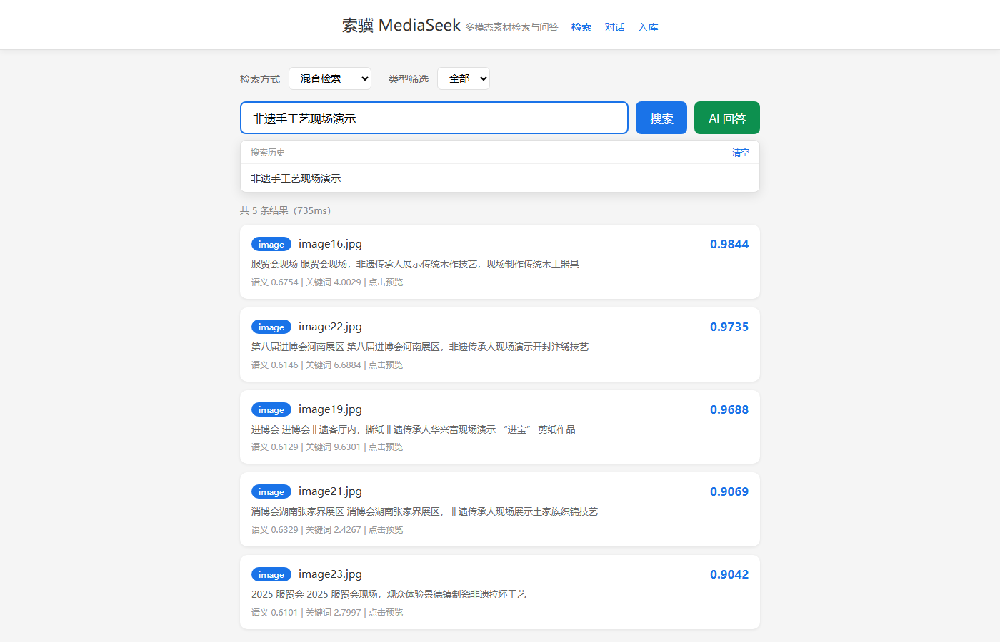
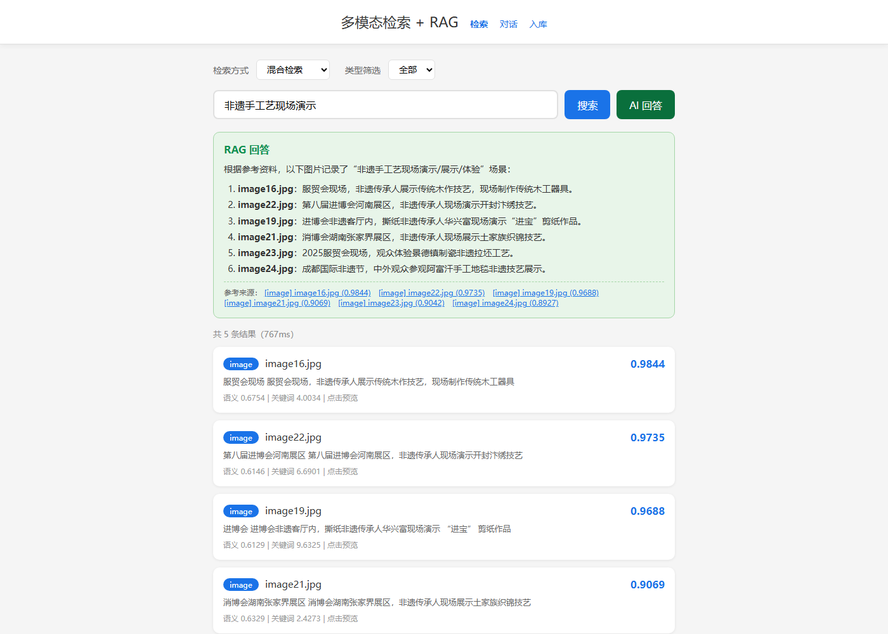
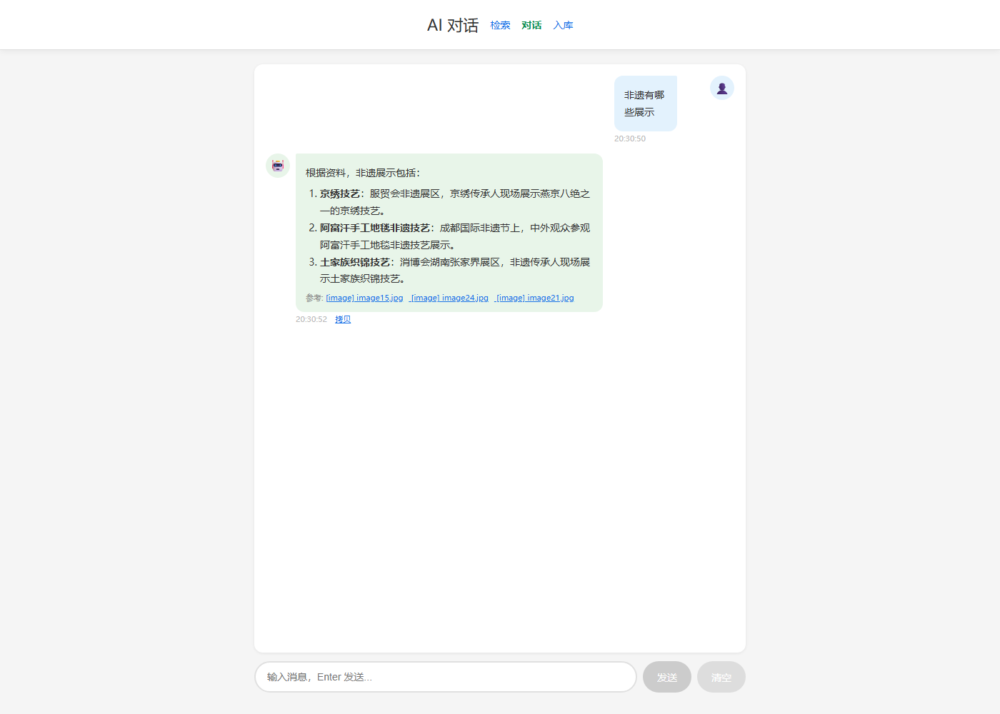

# 索骥 MediaSeek · 多模态素材检索与问答系统

> 按图索骥：给一句话，从 165 条图 / 视 / 音 / PDF 素材里把对的那条找出来，并让 AI 基于原文回答。

用 BGE-M3 对四种素材的标注文本做统一向量化，语义检索（ChromaDB）与关键词检索（BM25）
双路召回，RRF 融合排序；命中结果（含 PDF 正文切片）交给 DeepSeek 做 RAG 问答与多轮对话。

## 快速启动

```powershell
# 必须用装好依赖的解释器（Windows 商店版 python 缺 flask / FlagEmbedding）
cd C:\Users\niniu\Desktop\项目\索骥MediaSeek
C:\Users\niniu\anaconda3\python.exe web_app.py
```

浏览器打开 <http://localhost:5000>。首次启动会加载 2.2 GB 的 BGE-M3 模型，约 15~20 秒。

DeepSeek Key 优先读环境变量 `DEEPSEEK_API_KEY`，没有就读项目根目录的 `api_key.txt`：

```powershell
$env:DEEPSEEK_API_KEY = "sk-..."
```

## 页面

| 路径 | 功能 |
|---|---|
| `/` | 检索（混合 / 语义 / 关键词 + 类型筛选 + RAG 回答） |
| `/chat` | 多轮对话，带会话记忆 |
| `/admin` | 上传文件 + 描述 → 编码 → 入库 |





## 数据与脚本

```
多模态数据/multi_data/   原始素材 + Excel 标注（image 58 / video 37 / audio 60 / pdf 10）
向量库/db_*.json         BGE-M3 编码结果（dense 1024 维 + sparse 权重）
chroma_db/               ChromaDB 持久化目录（multi_modal 165 条 + doc_chunks 162 段）
bge-m3/                  本地模型权重（2.2 GB，不随代码分发）
```

> **仓库里没有的东西**：`多模态数据/` 下的媒体文件（6.5 GB）和 `bge-m3/` 模型权重（2.2 GB）
> 都在 `.gitignore` 里，克隆后需要自行准备。标注表（`*.xlsx`）保留在仓库中，方便看清数据结构。
> 只跑检索 demo 的话，`向量库/*.json` 已入库，执行 `init_vector_db.py` 即可建起 ChromaDB，
> 不需要下载模型；要重新编码或做 RAG 才需要 BGE-M3 权重。

| 脚本 | 作用 | 什么时候跑 |
|---|---|---|
| `build_vector_db.py` | Excel 标注 → 编码 → `向量库/*.json` | 改了标注表 |
| `init_vector_db.py` | JSON → ChromaDB `multi_modal` | 重建向量库之后 |
| `chunk_index.py` | PDF 按 500 字切片 → `doc_chunks` | 批量新增 PDF 之后 |
| `web_app.py` | Flask 服务（检索 / RAG / 对话 / 入库） | 日常启动 |
| `check_consistency.py` | 校验 Excel ↔ 磁盘 ↔ JSON ↔ Chroma 四层一致 | 每次改完数据 |
| `evaluate.py` | 三种检索方式的 R@5 / MRR + 拒答测试 | 想复现评测数字 |
| `retrieval_benchmark.py` | 三种方式的耗时与 Top-1 命中对比 | 同上 |
| `relevance_test.py` | 人工盲评：Dense vs Sparse 谁更准 | 需要人肉打分 |

## 检索是怎么排的

1. 查询用 BGE-M3 编码一次，dense 向量查 ChromaDB 取前 50，BM25 对全库打分取前 50。
2. 两路名次做 RRF 融合（`k=60`，语义:关键词 = 1.0 : 0.5），融合分除以理论最大值归一化到 0~1。
3. 拒答：语义最高分 < 0.47 且关键词最高分（限当前筛选范围）< 3.0 时判为“语料里没有”，直接返回空。
4. RAG 上下文固定给 4 条主检索结果 + 2 段 PDF 切片——切片分数是裸余弦，
   和 RRF 归一化分不同尺度，混在一起排会被主检索全部挤掉。

## 评测结果

| 方式 | R@5 | MRR | 平均耗时 |
|---|---|---|---|
| 语义（ChromaDB 稠密） | 0.790 | 0.850 | 250.8 ms |
| 关键词（BM25 稀疏） | 0.505 | 0.650 | 205.2 ms |
| 混合（RRF 融合） | 0.765 | **0.950** | 201.7 ms |

语料外问题拒答 **8/8** 通过。评测集 10 条（`eval_set.json`），自动标注口径见 `evaluate.py` 顶部说明——
标注偏向关键词检索，所以看三者的相对差距，而不是绝对值。

## 关于“多模态”的边界

检索基于**人工标注的描述文本**构建统一文本向量空间，图片 / 视频 / 音频并不是被视觉或听觉模型编码的。
也就是说，这是“跨模态素材的统一文本检索”，不是跨模态编码。取舍原因：样本量小、没有成对的图文标注；
升级路径是视频抽帧跑 CLIP、音频跑 Whisper 转写后入库。

## 已知限制

- Flask 开发服务器单进程，`chat_sessions` 存在内存里（上限 200 个会话 × 8 轮）。
- 向量库是“全量重建”模式，增量入库走 `/admin`。
- `KMP_DUPLICATE_LIB_OK=TRUE` 用来压住 conda 与 pip 混装导致的 OpenMP 重复加载告警。
